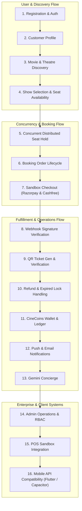

# CINEVENUE — END-TO-END STAGING VERIFICATION PLAN & TEST SUITE

**Document Version:** 1.1.0  
**Target Environment:** Staging Infrastructure (Connected Live PostgreSQL & Shared Redis)  
**Execution Standard:** Zero Mocking, Real Distributed Locking, Verified Sandbox Financials  
**Last Verified:** November 9, 2026  

---

## 1. COMPREHENSIVE STAGING VERIFICATION MATRIX

This plan defines the end-to-end operational verification across all 18 functional domains once staging infrastructure is provisioned. For each domain, step-by-step procedures, expected results, and external dependencies are strictly specified.

---

### Domain 1: Registration and Authentication
* **Target Endpoints:** `POST /api/v1/auth/register`, `POST /api/v1/auth/login`, `POST /api/v1/auth/refresh`
* **Test Procedure:**
  1. Register test user `staging_user_01@cinevenue.test` with password `Password123!Secure` and name `"Staging Tester"`.
  2. Inspect database record: verify password hash uses bcrypt with salt rounds $\ge 10$. Confirm plaintext password is never stored or returned.
  3. Login with registered credentials; verify response contains `accessToken` (1h expiry) and `refreshToken` (7d expiry).
  4. Call `POST /api/v1/auth/refresh` using refresh token; verify refreshed access token is returned.
  5. Attempt 26 rapid failed login attempts from same IP; verify rate limiter triggers HTTP 429 (`TooManyRequests`) on 26th attempt.
* **Expected Result:** HTTP 201 with valid JWT tokens; HTTP 200 on login and refresh; HTTP 429 on brute-force attempts.
* **Dependencies:** Staging PostgreSQL database (`User` table), `JWT_ACCESS_SECRET`, `JWT_REFRESH_SECRET`.

---

### Domain 2: Customer Profile Management
* **Target Endpoints:** `GET /api/v1/auth/me`, `PUT /api/v1/auth/profile`
* **Test Procedure:**
  1. Authenticate with customer JWT and call `GET /api/v1/auth/me`.
  2. Verify response includes `id`, `email`, `name`, `mobile`, `role: "CUSTOMER"`, and does NOT include `passwordHash`.
  3. Update profile via `PUT /api/v1/auth/profile` with `{"name": "Updated Staging Name", "mobile": "9876543210"}`.
  4. Verify updated name persists in PostgreSQL and subsequent `GET /api/v1/auth/me` returns updated values.
* **Expected Result:** HTTP 200 with sanitized user profile payload; successful atomic update of user attributes.
* **Dependencies:** Valid customer JWT, Staging PostgreSQL database.

---

### Domain 3: Movie and Theatre Discovery
* **Target Endpoints:** `GET /api/v1/movies`, `GET /api/v1/theatres`
* **Test Procedure:**
  1. Query active movies for city `"Mumbai"` via `GET /api/v1/movies?city=Mumbai`.
  2. Verify returned list filters movies by the selected city and returns poster URL, title, rating, formats (IMAX, 2D), and language.
  3. Query theatres via `GET /api/v1/theatres?city=Mumbai`.
  4. Verify theatre objects include name, address, screen count, and active status.
* **Expected Result:** HTTP 200 with structured JSON array; inactive movies/theatres are filtered out.
* **Dependencies:** Staging PostgreSQL seeded with sample movie and theatre records.

---

### Domain 4: Show Selection and Seat Availability
* **Target Endpoints:** `GET /api/v1/shows`, `GET /api/v1/shows/:id/seats`
* **Test Procedure:**
  1. Query scheduled shows for movie ID and date via `GET /api/v1/shows?movieId=m1&date=today`.
  2. Select show ID `show_staging_01` and call `GET /api/v1/shows/show_staging_01/seats`.
  3. Inspect seat layout: verify seat tiers (VIP, Premium, Executive), rows, numbers, base pricing, and status (`AVAILABLE`, `LOCKED`, `BOOKED`).
* **Expected Result:** HTTP 200 with complete grid representation matching the screen's physical configuration.
* **Dependencies:** Staging PostgreSQL (`Show`, `Screen`, `Seat`, `ShowSeat` tables).

---

### Domain 5: Concurrent Seat Locking (Redis Distributed Engine)
* **Target Endpoints:** `POST /api/v1/bookings/lock-seats`, `POST /api/v1/bookings/release-seats`
* **Test Procedure:**
  1. User A locks seats `["s_A1", "s_A2"]` for show `show_staging_01` via `POST /api/v1/bookings/lock-seats` with `{ showId, seatIds, userId: "user_A" }`.
  2. Inspect Redis: verify key `lock:show_staging_01:seat:s_A1` exists with value and TTL $\approx 600$ seconds.
  3. User B simultaneously attempts to lock `["s_A2", "s_A3"]` for the same show.
  4. Verify User B request is rejected with `HTTP 409 Conflict`.
  5. Verify partial collision rollback: seat `s_A3` was rolled back and remains completely available.
  6. Release locks cleanly via `POST /api/v1/bookings/release-seats`.
* **Expected Result:** Atomic lock acquisition; HTTP 409 on collision; zero split-brain or double-booked seats.
* **Dependencies:** Dedicated staging Redis 7.x instance (`REDIS_URL`).

---

### Domain 6: Booking Order Lifecycle
* **Target Endpoint:** `POST /api/v1/bookings/create`
* **Test Procedure:**
  1. Call booking creation with show ID, locked seat IDs, and customer credentials.
  2. Verify booking is created in database with status `INITIATED` or `PENDING_PAYMENT`.
  3. Verify convenience fee calculation: matches centralized pricing slabs (Base charge + 18% GST).
  4. Verify `expiresAt` matches the 10-minute hold window.
* **Expected Result:** Immutable booking record created; exact breakdown of ticket subtotal, convenience fee, and GST.
* **Dependencies:** Active seat locks in Redis, Staging PostgreSQL database.

---

### Domain 7: Razorpay Sandbox Checkout
* **Target Endpoints:** `POST /api/v1/payments/razorpay/create-order`, `POST /api/v1/payments/razorpay/verify-payment`
* **Test Procedure:**
  1. Call order creation with booking ID; verify returned `orderId` starts with `order_`.
  2. Verify amount matches booking total in paise (e.g. ₹250.00 = 25000 paise).
  3. In test client, complete sandbox payment using standard test card `4111 1111 1111 1111`.
  4. Submit payment verification payload (`razorpay_order_id`, `razorpay_payment_id`, `razorpay_signature`).
  5. Verify HMAC-SHA256 signature verification succeeds in backend.
* **Expected Result:** HTTP 200 with verified payment status; booking transitions to `CONFIRMED`.
* **Dependencies:** `RAZORPAY_KEY_ID` (`rzp_test_...`), `RAZORPAY_KEY_SECRET`, `RAZORPAY_ENV=TEST`.

---

### Domain 8: Cashfree Sandbox Checkout
* **Target Endpoints:** `POST /api/v1/payments/create-order`, `POST /api/v1/payments/verify-payment`
* **Test Procedure:**
  1. Call Cashfree order creation with `itemType: "MOVIE"`.
  2. Verify response includes `payment_session_id` from Cashfree Sandbox PG API v2023-08-01.
  3. Complete payment simulation with Cashfree test card `4012 0000 0000 0002`.
  4. Verify payment verification succeeds and booking transitions to `CONFIRMED`.
* **Expected Result:** HTTP 200 with confirmed payment session; zero live banking interactions.
* **Dependencies:** `CASHFREE_APP_ID`, `CASHFREE_SECRET_KEY`, `CASHFREE_ENV=TEST`.

---

### Domain 9: Webhook Signature Security & Idempotency
* **Target Endpoints:** `POST /api/v1/payments/razorpay/webhook`, `POST /api/v1/payments/webhook`
* **Test Procedure:**
  1. Generate synthetic webhook payload (`event: "order.paid"`).
  2. Sign body with `RAZORPAY_WEBHOOK_SECRET` via HMAC-SHA256 into header `X-Razorpay-Signature`.
  3. Post to webhook endpoint: verify HTTP 200 acknowledgment.
  4. Post tampered body with same signature: verify HTTP 400 rejection.
  5. Send duplicate `order.paid` webhook for already confirmed booking: verify handler acknowledges HTTP 200 without duplicate database mutations or double-crediting CineCoins.
* **Expected Result:** Tampered payloads rejected with HTTP 400; duplicate webhooks handled idempotently.
* **Dependencies:** `RAZORPAY_WEBHOOK_SECRET` / `CASHFREE_WEBHOOK_SECRET`.

---

### Domain 10: Automatic Individual QR Ticket Generation & Verification
* **Target Endpoints:** `GET /api/v1/bookings/:bookingId`, `POST /api/v1/tickets/verify-qr`
* **Test Procedure:**
  1. For a confirmed booking with 3 seats (`A1`, `A2`, `A3`), inspect generated tickets.
  2. Verify booking contains 3 distinct ticket records, each with a unique cryptographic QR token (`qrToken`).
  3. Verify QR token contains zero sensitive data (no credit card numbers, CVVs, or customer passwords).
  4. Submit token to `/api/v1/tickets/verify-qr`: verify gate check-in returns seat number, movie title, hall name, and marks ticket as `isUsed: true`.
  5. Rescan the same QR token: verify response indicates `ALREADY_CHECKED_IN` with timestamp.
* **Expected Result:** 1 unique QR pass per seat; atomic gate check-in; duplicate check-in strictly flagged.
* **Dependencies:** Confirmed booking record, Staging PostgreSQL database.

---

### Domain 11: Refund and Cancellation Behavior
* **Target Endpoints:** `POST /api/v1/bookings/:id/cancel`
* **Test Procedure:**
  1. Customer requests cancellation before show cutoff time.
  2. Verify cancellation eligibility check (convinience fee retention rules applied).
  3. Verify seat status reverts from `BOOKED` to `AVAILABLE`.
  4. Verify sandbox refund request is queued/dispatched to gateway.
  5. Late payment collision simulation: Customer payment confirms after 10-minute hold expired and seat was taken by another user.
  6. Verify booking transitions to `EXPIRED_REFUND_PENDING` and queues automatic refund.
* **Expected Result:** Seats freed immediately; refund ledger entry created; zero double-booking.
* **Dependencies:** Staging PostgreSQL, Sandbox payment gateway connection.

---

### Domain 12: CineCoins Loyalty Program
* **Target Endpoints:** `GET /api/v1/cinecoins/balance`, `POST /api/v1/cinecoins/redeem`
* **Test Procedure:**
  1. Verify customer earns 1 CineCoin per ₹100 spent upon confirmed booking.
  2. Inspect `CineCoinsTransaction` table: verify credit ledger entry with reference to booking ID.
  3. Redeem 50 CineCoins against a new booking.
  4. Verify deduction is executed inside Prisma `$transaction` with debit ledger entry.
  5. Verify balance cannot go negative.
* **Expected Result:** Atomic balance calculation; immutable audit trail; rollback on failed booking.
* **Dependencies:** Staging PostgreSQL database (`CineCoinsTransaction`, `CineCoinsUserWallet`).

---

### Domain 13: Push and Email Notification Delivery
* **Target Endpoints:** `POST /api/v1/notifications/device-tokens`, `POST /api/v1/notifications/send-push`
* **Test Procedure:**
  1. Register staging device token via `POST /api/v1/notifications/device-tokens`.
  2. Trigger booking confirmation notification.
  3. Verify delivery dispatch:
     - If FCM/APNs configured: verify real API response from provider with message ID.
     - If omitted: verify backend logs `PUSH_PROVIDER_UNCONFIGURED` and returns HTTP 503 (never fakes delivery).
  4. Verify transactional confirmation email dispatched to staging inbox (e.g. Mailtrap or Resend test domain).
* **Expected Result:** Real provider acknowledgment or explicit fail-closed unconfigured status.
* **Dependencies:** Optional test credentials for FCM/APNs and SMTP/Resend.

---

### Domain 14: Gemini VIP Concierge
* **Target Endpoint:** `POST /api/v1/concierge/chat`
* **Test Procedure:**
  1. Send chat message: `"Can you recommend a luxury screening in Mumbai tonight?"`
  2. Verify response incorporates live showtimes via catalog grounding.
  3. Verify response is styled according to CineVenue luxury concierge tone.
  4. Test with invalid/empty prompt: verify clean error handling.
* **Expected Result:** HTTP 200 with grounded AI recommendations; response latency $< 3$ seconds.
* **Dependencies:** `GEMINI_API_KEY` with active quota.

---

### Domain 15: Admin Operations & RBAC
* **Target Endpoints:** `POST /api/v1/admin/login`, `GET /api/v1/admin/theatres`, `POST /api/v1/admin/sync/spotlight`
* **Test Procedure:**
  1. Attempt admin login with default passcode `8888`: verify immediate rejection.
  2. Login with configured `ADMIN_PASSCODE` and `SUPER_ADMIN_PASSWORD`: verify elevated JWT returned.
  3. Attempt accessing `/admin/theatres` with customer token: verify `HTTP 403 Forbidden`.
  4. Update Editor's Spotlight movie via Super Admin endpoint; verify realtime event broadcast to active clients.
* **Expected Result:** Strict role-based enforcement; Super Admin privilege verification; real-time sync.
* **Dependencies:** Configured `ADMIN_PASSCODE` ($\ge 12$ chars) and `SUPER_ADMIN_PASSWORD`.

---

### Domain 16: POS Sandbox Integration
* **Target Endpoints:** `POST /api/v1/pos/availability/:theatreId/:showId`, `POST /api/v1/webhooks/pos/:integrationId`
* **Test Procedure:**
  1. Configure mock Vista / RTS POS integration record with sandbox endpoint URL.
  2. Query live availability: verify remote seat status correctly maps to CineVenue grid.
  3. Submit POS external hold request: confirm hold ID is stored in CineVenue booking record.
* **Expected Result:** Bidirectional seat state synchronization; external hold ID tracked in database.
* **Dependencies:** Staging PostgreSQL (`PosIntegration` table).

---

### Domain 17: Mobile API Compatibility (Flutter & Capacitor)
* **Target Endpoints:** Mobile client connecting to `https://staging-api.cinevenue.com`
* **Test Procedure:**
  1. Launch mobile app with staging API endpoint.
  2. Execute user registration and login flow from mobile UI.
  3. Verify device token registration (`POST /api/v1/notifications/device-tokens`).
  4. Execute seat selection, order creation, and test gateway launch on mobile viewport.
  5. Verify QR ticket displays clearly on mobile screen and can be scanned by gate scanner.
* **Expected Result:** Mobile app communicates seamlessly with staging API; zero CORS or header rejections.
* **Dependencies:** Deployed Vercel Preview backend, mobile staging build.

---

### Domain 18: Multi-Instance Distributed Locking Stress Test
* **Test Procedure:**
  1. Deploy 2 independent backend instances or test workers.
  2. Simultaneously transmit seat lock requests for the exact same seat (`SEAT_PREMIUM_01`) at the exact same millisecond.
  3. Verify exactly 1 instance receives HTTP 200 and the other receives HTTP 409 Conflict.
  4. Confirm zero database writes occurred for the rejected instance.
* **Expected Result:** 100% collision prevention under true multi-instance concurrent load.
* **Dependencies:** External shared Redis instance (`REDIS_URL`), multi-worker test runner.
