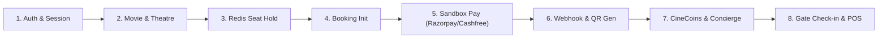

# CINEVENUE — END-TO-END STAGING VERIFICATION PLAN & TEST SUITE

**Document Version:** 1.0.0  
**Target Environment:** Staging Infrastructure (Connected Live PostgreSQL & Shared Redis)  
**Execution Standard:** Zero Mocking, Real Distributed Locking, Verified Sandbox Financials  
**Last Verified:** November 9, 2026  

---

## 1. 15-DOMAIN STAGING VERIFICATION MATRIX

This plan covers end-to-end operational verification across all 15 functional domains once staging infrastructure is provisioned.



---

### Domain 1: User Registration & Session Management
* **Endpoints:** `POST /api/v1/auth/register`, `POST /api/v1/auth/login`, `POST /api/v1/auth/refresh`
* **Test Procedure:**
  1. Register a test user `staging_user_01@cinevenue.test` with password `Password123!`.
  2. Verify bcrypt hash in database. Confirm password plaintext is never stored or returned.
  3. Login with credentials; verify returned `accessToken` (valid 1 hour) and `refreshToken` (valid 7 days).
  4. Call `POST /api/v1/auth/refresh` with refresh token; verify new access token is generated without re-entering credentials.
  5. Attempt 26 rapid failed logins from same IP; verify rate limiter triggers HTTP 429 (`TooManyRequests`) on 26th attempt.
* **Pass Criteria:** Valid JWT decoded with subject and role `CUSTOMER`; HTTP 429 triggered on auth spam.

---

### Domain 2: Movie Browsing & Theatre Showtimes
* **Endpoints:** `GET /api/v1/movies`, `GET /api/v1/theatres`, `GET /api/v1/theatres/shows/:showId`
* **Test Procedure:**
  1. Query active movies for city `"Mumbai"`. Verify returned list filters by selected city.
  2. Query theatres showing movie `"Bagheera"`. Verify theatre name, sound format (Dolby Atmos), and screen tiers.
  3. Inspect show schedule: verify show start time, end time, and base ticket prices per tier (e.g. VIP ₹250, Premium ₹180).
* **Pass Criteria:** Accurate show schedule metadata returned; non-active theatres filtered out.

---

### Domain 3: Real-Time Seat Selection & Distributed Seat Locking
* **Endpoint:** `POST /api/v1/bookings/lock-seats`
* **Test Procedure:**
  1. User A locks seats `["s_A1", "s_A2"]` for show `show_staging_1` with payload `{"showId": "show_staging_1", "seatIds": ["s_A1", "s_A2"], "userId": "user_A"}` with TTL 600 seconds (10 minutes).
  2. Inspect Redis: verify key `lock:show_staging_1:seat:s_A1` exists with value `{"userId": "user_A", ...}` and TTL $\approx 600$.
  3. User B simultaneously attempts to lock `["s_A2", "s_A3"]` via `POST /api/v1/bookings/lock-seats`.
  4. Verify User B request is rejected with `HTTP 409 Conflict`.
  5. Verify partial collision cleanup: `s_A3` was rolled back and is completely free.
  6. Release lock via `POST /api/v1/bookings/release-seats` with `{"showId": "show_staging_1", "seatIds": ["s_A1", "s_A2"], "userId": "user_A"}`.
* **Pass Criteria:** Atomic Lua script guarantees zero split-brain seat hold.

---

### Domain 4: Booking Order Creation
* **Endpoint:** `POST /api/v1/bookings/create`
* **Test Procedure:**
  1. Call booking creation with show ID, selected seat IDs, and customer metadata.
  2. Verify booking is created in database with status `INITIATED` or `PENDING_PAYMENT`.
  3. Verify convenience fee calculation: matches authoritative slab pricing (Base fee + 18% GST).
* **Pass Criteria:** Immutable booking record created; `expiresAt` matches 10-minute hold window.

---

### Domain 5: Razorpay Sandbox Checkout
* **Endpoints:** `POST /api/v1/payments/razorpay/create-order`, `POST /api/v1/payments/razorpay/verify-payment`
* **Test Procedure:**
  1. Call order creation; verify returned `razorpayOrderId` starts with `order_`.
  2. In frontend or test runner, simulate checkout using test card `4111 1111 1111 1111`, expiry `12/28`, CVV `123`.
  3. Submit payment verification payload (`razorpay_order_id`, `razorpay_payment_id`, `razorpay_signature`).
  4. Verify HMAC-SHA256 signature verification succeeds.
* **Pass Criteria:** Verified payment updates booking to `CONFIRMED`.

---

### Domain 6: Cashfree Sandbox Checkout
* **Endpoints:** `POST /api/v1/payments/create-order`, `POST /api/v1/payments/verify-payment`
* **Test Procedure:**
  1. Call Cashfree order creation with `itemType: "MOVIE"`.
  2. Verify response includes `payment_session_id` from Cashfree Sandbox PG API v2023-08-01.
  3. Complete payment simulation with Cashfree test card `4012 0000 0000 0002`.
* **Pass Criteria:** Payment session verified; booking status transitions to `CONFIRMED`.

---

### Domain 7: Webhook Signature Verification
* **Endpoints:** `POST /api/v1/payments/razorpay/webhook`, `POST /api/v1/payments/webhook`
* **Test Procedure:**
  1. Generate synthetic webhook payload (`event: "order.paid"`).
  2. Sign body with `RAZORPAY_WEBHOOK_SECRET` via HMAC-SHA256 into header `X-Razorpay-Signature`.
  3. Post to webhook endpoint: verify HTTP 200 acknowledgment.
  4. Send tampered body with same signature: verify HTTP 400 rejection.
* **Pass Criteria:** Tampered payloads strictly rejected; valid payloads accepted.

---

### Domain 8: Duplicate Webhook Idempotency
* **Test Procedure:**
  1. Deliver a valid `order.paid` webhook for already confirmed booking `bkg_staging_100`.
  2. Verify handler detects `status === 'CONFIRMED'`.
  3. Confirm system immediately returns HTTP 200 without executing duplicate database updates or re-crediting CineCoins.
* **Pass Criteria:** Zero duplicate passes, zero duplicate wallet transactions.

---

### Domain 9: Automatic Individual QR Ticket Generation
* **Endpoint:** `GET /api/v1/bookings/:bookingId` & `POST /api/v1/tickets/verify-qr`
* **Test Procedure:**
  1. For a booking with 3 seats (`A1`, `A2`, `A3`), verify booking record contains 3 distinct items.
  2. Verify each item has a unique, cryptographically signed QR token (`qrCode`).
  3. Scan QR token at `/api/v1/tickets/verify-qr`; verify it reveals seat number, movie, and hall without exposing customer phone or payment tokens.
* **Pass Criteria:** 1 token per seat; zero PII leakage.

---

### Domain 10: Booking Cancellation & Expired Lock Refund Queueing
* **Test Procedure:**
  1. Simulate seat-lock expiration: hold seats for 1 second, then release Redis lock.
  2. Customer B locks and books the seat.
  3. Late payment confirmation arrives for Customer A.
  4. Verify system detects seat conflict, does NOT double-book, sets Customer A booking to `EXPIRED_REFUND_PENDING`, and queues automatic refund.
* **Pass Criteria:** Conflict caught safely; refund queue record created.

---

### Domain 11: CineCoins Wallet Operations
* **Endpoints:** `GET /api/v1/cinecoins/balance`, `POST /api/v1/cinecoins/redeem`
* **Test Procedure:**
  1. Verify customer earns 1 CineCoin per ₹100 spent upon confirmed booking.
  2. Redeem 50 CineCoins against a new booking.
  3. Verify deduction is executed inside Prisma `$transaction` with debit ledger entry.
* **Pass Criteria:** Wallet balance updates atomically; balance cannot go negative.

---

### Domain 12: Gemini VIP Concierge
* **Endpoint:** `POST /api/v1/concierge/chat`
* **Test Procedure:**
  1. Send message: `"Can you recommend an action film in Mumbai this Friday?"`
  2. Verify response incorporates live showtimes via grounding and returns luxury black-and-gold styled recommendation.
* **Pass Criteria:** Response returns in $< 3$ seconds with relevant movies.

---

### Domain 13: Push Notification Delivery
* **Endpoint:** `POST /api/v1/notifications/send-push`
* **Test Procedure:**
  1. Register staging device token via `POST /api/v1/notifications/device-tokens`.
  2. Trigger booking confirmation push.
  3. Verify FCM HTTP API receives dispatch and returns message ID.
* **Pass Criteria:** Real delivery acknowledgment from Google FCM / Apple APNs.

---

### Domain 14: POS Sandbox Integration
* **Endpoints:** `POST /api/v1/pos/availability/:theatreId/:showId`, `POST /api/v1/webhooks/pos/:integrationId`
* **Test Procedure:**
  1. Configure Vista POS sandbox adapter (`https://api-sandbox.vista.co/v1`).
  2. Query live availability: verify remote seat status maps to CineVenue seat grid.
  3. Issue POS hold request: confirm external hold ID is stored in booking record.
* **Pass Criteria:** Real-time synchronization between POS inventory and web booking engine.

---

### Domain 15: Admin Authentication & Authorization
* **Endpoints:** `POST /api/v1/admin/login`, `GET /api/v1/admin/theatres`
* **Test Procedure:**
  1. Attempt admin login with default passcode `8888`: verify immediate rejection.
  2. Login with configured `ADMIN_PASSCODE` and `SUPER_ADMIN_PASSWORD`: verify elevated JWT returned.
  3. Customer token accessing `/admin/theatres`: verify `HTTP 403 Forbidden`.
* **Pass Criteria:** Role-based access control strictly enforced.

---

## 2. CRITICAL CONCURRENCY & FINANCIAL ATOMICITY TEST SUITE

Execute this automated test script against staging to confirm multi-instance concurrency:

```typescript
// scripts/staging_concurrency_audit.ts
import fetch from "node-fetch";

async function runStagingConcurrencyAudit() {
  const STAGING_API_INSTANCE_1 = "https://staging-api-1.cinevenue.com/api/v1";
  const STAGING_API_INSTANCE_2 = "https://staging-api-2.cinevenue.com/api/v1";
  const targetShowId = "show_staging_concurrency_01";
  const contestedSeat = "SEAT_GOLD_99";

  console.log("⚡ Initiating simultaneous seat-lock collision across 2 instances...");

  // Send simultaneous lock requests
  const [res1, res2] = await Promise.all([
    fetch(`${STAGING_API_INSTANCE_1}/bookings/lock-seats`, {
      method: "POST",
      headers: { "Content-Type": "application/json" },
      body: JSON.stringify({ showId: targetShowId, seatIds: [contestedSeat], userId: "user_alpha" })
    }),
    fetch(`${STAGING_API_INSTANCE_2}/bookings/lock-seats`, {
      method: "POST",
      headers: { "Content-Type": "application/json" },
      body: JSON.stringify({ showId: targetShowId, seatIds: [contestedSeat], userId: "user_beta" })
    })
  ]);

  const json1 = await res1.json();
  const json2 = await res2.json();

  console.log("Instance 1 Result:", res1.status, json1);
  console.log("Instance 2 Result:", res2.status, json2);

  const oneSucceeded = (res1.status === 200 && res2.status === 409) || (res1.status === 409 && res2.status === 200);
  if (!oneSucceeded) {
    throw new Error("❌ CONCURRENCY VIOLATION: Distributed seat lock failed to prevent double-booking!");
  }

  console.log("✅ PASS: Distributed lock strictly prevented split-brain double hold.");
}

runStagingConcurrencyAudit();
```

---

## 3. FLUTTER MOBILE APP STAGING VERIFICATION & CI/CD

### Prerequisites
* **Flutter SDK:** Version `>=3.19.0` (Recommended: Flutter 3.24.x LTS or 3.27.x).
* **Dart SDK:** `>=3.3.0 <4.0.0`.
* **Android Studio:** Jellyfish or Koala (JDK 17, Android SDK Platform 34, Build Tools 34.0.0).
* **Xcode:** 15.x or 16.x (macOS Sonoma / Sequoia for iOS archive builds).

### Build & Release Commands
```bash
# Navigate to mobile codebase
cd cinevenue_mobile

# 1. Dependency sync & code generation
flutter pub get
dart run build_runner build --delete-conflicting-outputs

# 2. Static analysis & unit tests
flutter analyze
flutter test

# 3. Android Staging Build (Split APKs & App Bundle)
flutter build apk --release --split-per-abi --dart-define=VITE_API_URL=https://staging-api.cinevenue.com
flutter build appbundle --release --dart-define=VITE_API_URL=https://staging-api.cinevenue.com

# 4. iOS Staging Build (Requires macOS)
cd ios && pod install && cd ..
flutter build ipa --release --dart-define=VITE_API_URL=https://staging-api.cinevenue.com
```

---

## 4. PHYSICAL POS HARDWARE INTEGRATION (Pending On-Site Testing)

The POS adapters in CineVenue software are unit-tested and sandbox-verified. Real hardware sign-off requires physical on-site testing once venue terminals are provisioned:

| Hardware Component | Device Specifications | Verification Required on Staging |
| :--- | :--- | :--- |
| **Thermal Ticket Printer** | ESC/POS 80mm thermal receipt printer (Epson TM-T82 / Star Micronics) | Print physical ticket with clear, readable QR code at 203 DPI. |
| **2D Barcode Scanner** | Zebra / Honeywell / Sunmi USB & Bluetooth handheld scanner | Scan customer mobile screen at gate; verify $< 300\text{ms}$ check-in response. |
| **EMV Payment EDC Terminal** | Pine Labs / MSwipe / Mosambee POS card terminal | Swipe, chip, and NFC contactless card payments with synchronous transaction callback. |
